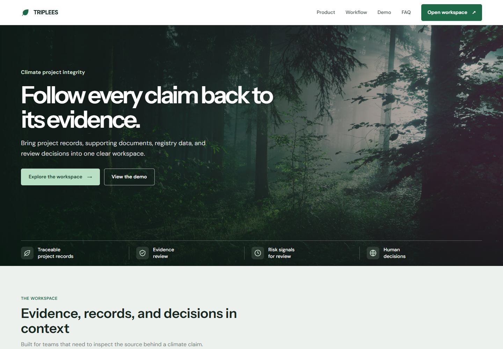
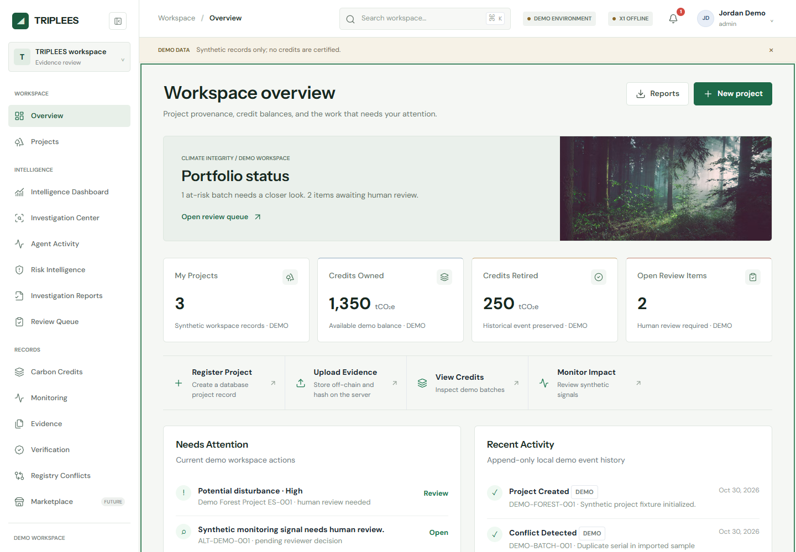
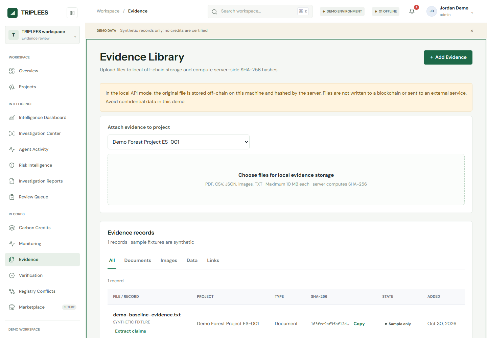
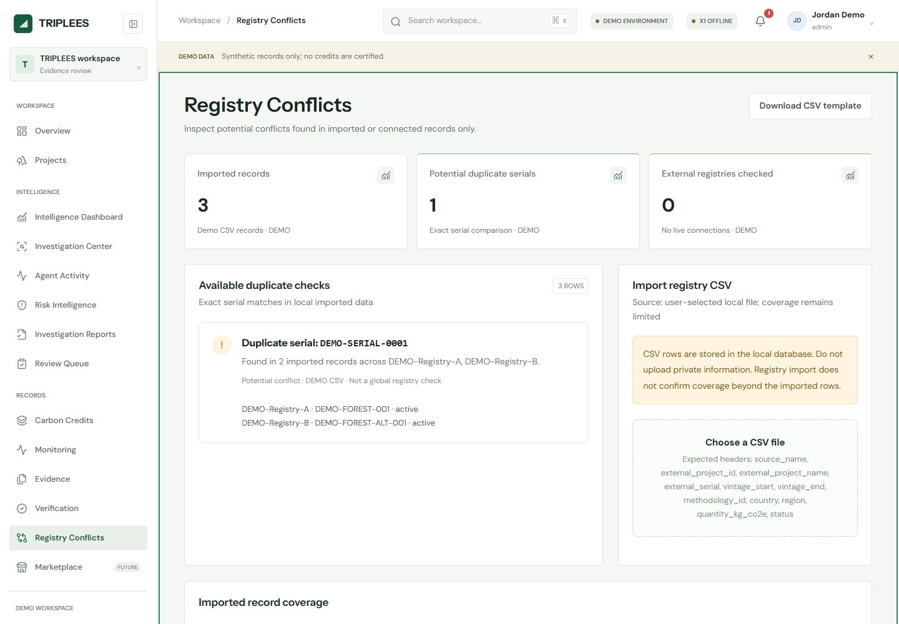
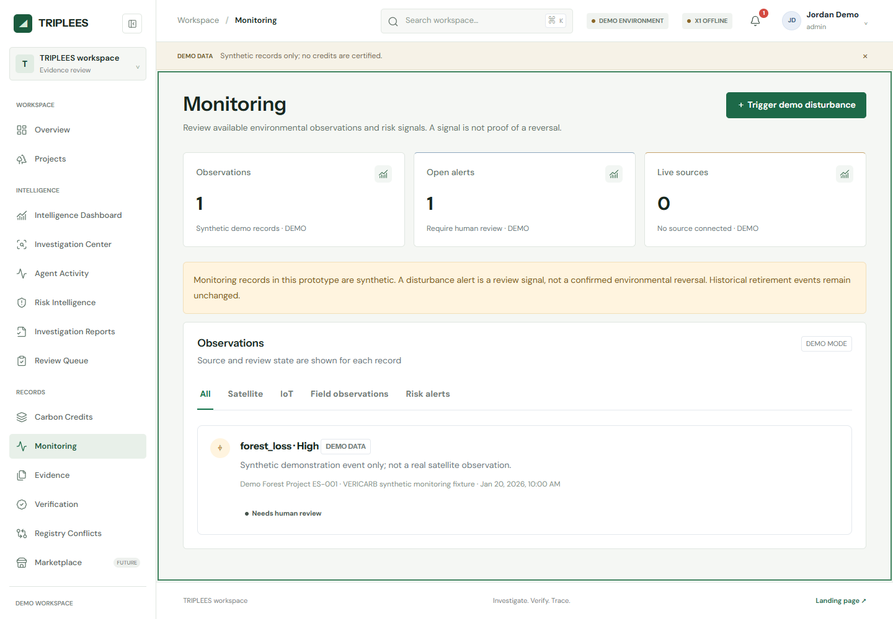

# TRIPLEES | Evidence Intelligence for Carbon Markets

**Investigate. Verify. Trace.**

TRIPLEES is an evidence-first workspace for investigating carbon projects and making their supporting records easier to examine. It brings documents, registry imports, monitoring observations, structured analysis, reviewer decisions, and tamper-evident report commitments into one auditable workflow.

The aim is practical: help teams move from scattered project records to clear, source-linked findings, while keeping uncertainty visible and human judgment in control. TRIPLEES treats AI as an analytical assistant, not an authority; deterministic checks and reviewer decisions remain distinct from model-generated suggestions.

**Project status:** research and demonstration prototype with synthetic demo data and a recorded X1 EcoChain testnet deployment. It is not a production credit registry, certification service, or live marketplace. A blockchain record can show that an identifier or hash was recorded; it cannot establish that an environmental claim is true.

[Product tour](#product-tour) · [Workflow](#workflow-at-a-glance) · [Getting started](#getting-started) · [Technology](#technology) · [Documentation](#documentation)

## What TRIPLEES Does

TRIPLEES organizes the investigation lifecycle around traceable inputs and reviewable outputs:

1. **Collect and fingerprint evidence.** Manage project records, extract supported document text, retain source locations, and calculate SHA-256 digests for stored evidence.
2. **Analyze within defined roles.** Five bounded agents cover evidence, public research, registry integrity, monitoring, and independent review. Each works from caller-provided context and reports its sources and limitations.
3. **Build a review trail.** Persist investigations, agent activity, findings, report versions, and reviewer decisions so that conclusions can be examined against their inputs.
4. **Anchor approved records.** Where explicitly configured and approved, record project or evidence identifiers on X1 EcoChain and commit reviewer-approved report digests. Evidence files and report contents remain off-chain.

The result is an investigation workflow designed for explainability: distinguish imported facts from synthetic examples, deterministic checks from AI suggestions, and a recorded hash from proof of an environmental outcome.

## Capabilities

- Project and evidence management with SHA-256 evidence hashing and authenticated evidence access.
- Opt-in text extraction for PDF, CSV, JSON, and TXT, including source locations, chunks, and heuristic claim candidates.
- Five scoped agent roles for evidence analysis, public research, registry integrity, monitoring, and independent review.
- Persistent investigations, agent execution history, source-linked findings, versioned reports, and reviewer decisions.
- An optional, separately approved X1 workflow for reviewer-approved report SHA-256 commitments; report contents remain off-chain.
- Registry imports with conflict checks limited to the records provided.
- Imported or synthetic monitoring signals and deterministic assessments. No live satellite, IoT, or field-monitoring feed is connected by default.
- Local batch issuance, transfer, retirement, and public verification workflows, with selected project, evidence, and issuance operations available on X1 testnet.

## Product Tour

These five screens were captured from the running local demo on October 30, 2026. The records shown are synthetic examples, not live project data or certified credits. The workspace clearly labels its demo state, disconnected external services, and review limitations. No external AI inference or blockchain transaction was used to create these screenshots.

### 1. Public entry point

The landing page introduces the product's central idea: follow a carbon-market claim back to its records. From here, a reviewer can enter the workspace and explore the product workflow.



### 2. Portfolio overview

The dashboard brings project count, demo credit balances, open review work, monitoring alerts, and recent activity into one place. The sample at-risk and review items are navigation cues for the underlying records, not automated verdicts.



### 3. Evidence library and fingerprints

Evidence is stored off-chain. The API computes a SHA-256 digest for each file so a later copy can be checked for byte-for-byte integrity. A digest is a fingerprint, not proof that a document is authentic or that its claims are true. Text extraction is an explicit action and can preserve locations such as page, row, or field references.



### 4. Registry record comparison

The example import contains the same serial in two supplied records. TRIPLEES flags the exact match and shows both source rows for a reviewer to inspect. This check covers only the records imported into this workspace; it does not query or certify against every external registry.



### 5. Monitoring signals for review

The monitoring view shows the source and review state alongside a synthetic forest-loss signal. It is deliberately labeled as demo data: there is no live satellite, IoT, or field feed, and an alert is a prompt for investigation rather than confirmation of environmental damage or reversal.



## Workflow at a Glance

TRIPLEES keeps source material, analysis, and decisions distinct so a reviewer can trace how a report was produced:

1. **Create a project and attach records.** Project details, uploaded documents, imported registry rows, and monitoring observations are stored as separate records. Evidence files stay off-chain in configured local or object storage.
2. **Fingerprint and extract evidence.** The API computes a SHA-256 digest when a file is stored. A user may explicitly request extraction for supported PDF, CSV, JSON, or text files; extracted passages retain source locations and candidate claims are not treated as verified facts.
3. **Run bounded checks.** Registry comparison checks imported rows for exact serial conflicts. Monitoring assessments evaluate supplied observations. These are scoped checks over available input, not global registry searches or live environmental monitoring.
4. **Investigate with scoped agents.** An investigation is queued for the database-backed worker. Evidence, research, integrity, monitoring, and independent-review roles receive bounded context and record their activity, sources, limitations, and structured outputs. Public research and external model inference are unavailable unless their providers are separately configured; sending selected evidence to Nebius requires explicit per-investigation authorization.
5. **Review and preserve a report.** Findings remain advisory until an authorized human reviews them. A reviewer records a reasoned decision, and report versions preserve what was reviewed at that point in time.
6. **Optionally anchor an approved digest.** A reviewer-approved report digest can be committed to X1 testnet only through a separately configured and explicitly approved operation. The report and evidence contents remain off-chain; a transaction proves a hash was recorded, not that the report is correct.

The five agent roles do not have arbitrary tools or authority to approve credits, sign transactions, or make environmental determinations. AI output is an aid to review, not a substitute for source inspection or human judgment.

## Repository Structure

```text
TRIPLEES/
|-- frontend/
|   |-- index.html              Public website
|   |-- auth.html               Sign-in and demo access
|   |-- app.html                Application workspace
|   |-- verify.html             Public batch verification
|   `-- assets/
|       |-- css/                Stylesheets
|       |-- js/                 Browser application code
|       `-- images/             Icons and local images
|-- services/
|   |-- api/
|   |   |-- app/                FastAPI routes, models, and business services
|   |   |-- migrations/         Alembic database migrations
|   |   |-- tests/              API and static-hosting tests
|   |   `-- requirements.txt    Python dependencies
|   `-- contracts/
|       |-- contracts/          Solidity registry
|       |-- scripts/            Deployment and testnet operations
|       |-- test/               Hardhat contract tests
|       `-- package.json        Contract tooling and commands
|-- docs/                       Architecture, walkthroughs, and runbooks
|-- sample-data/                Synthetic JSON fixtures and CSV templates
|-- .env.example                Configuration template without secrets
|-- .gitignore                  Local and generated file exclusions
|-- alembic.ini                 Database migration configuration
`-- README.md                   Project overview and getting started
```

The frontend is served at the site root, so moving the source files does not change URLs such as `/auth.html` or `/app.html`. FastAPI serves static content only from [frontend](frontend), not the repository root. API requests remain under `/api/`.

Local-only directories such as `data/`, `.venv/`, `node_modules/`, contract artifacts, and editor settings are intentionally excluded from the tracked project layout. Optional development utilities live under `tools/`.

## Technology

| Area | Stack |
| --- | --- |
| Frontend | HTML, CSS, vanilla JavaScript, Lucide icons |
| Backend | Python 3.11+, FastAPI, Pydantic, SQLAlchemy, httpx |
| Persistence | SQLite/PostgreSQL, Alembic migrations, local/S3-compatible off-chain evidence storage |
| Blockchain | Solidity, Hardhat, ethers, Web3.py, X1 Maculatus testnet |
| Tests | pytest, FastAPI TestClient, Hardhat |

## Getting Started

Use Python 3.11 or newer and Node.js 20+. From the repository root:

### 1. Install dependencies

```powershell
python -m venv .venv
.\.venv\Scripts\Activate.ps1
python -m pip install -r services\api\requirements.txt
npm --prefix services\contracts ci
```

### 2. Configure the application

For a fresh checkout, create a local configuration file:

```powershell
Copy-Item .env.example .env
```

Keep an existing `.env` rather than overwriting it. `VERICARB_TOKEN_SECRET` is a legacy-compatible setting; use a long random value. The default database and evidence directories are created locally when the application starts. Production startup stays blocked until production identity and session controls are integrated; see [Production operations](docs/PRODUCTION_OPERATIONS.md).

### 3. Start the application

```powershell
python -m uvicorn services.api.app.main:app --reload --host 127.0.0.1 --port 8000
```

| Page | Local URL |
| --- | --- |
| Public website | [localhost:8000](http://localhost:8000/) |
| Sign-in and demo access | [localhost:8000/auth.html](http://localhost:8000/auth.html) |
| Application workspace | [localhost:8000/app.html](http://localhost:8000/app.html) |
| Interactive API documentation | [localhost:8000/api/docs](http://localhost:8000/api/docs) |

Select **Explore the demo workspace** on the sign-in page to load synthetic records. No separate frontend server or JavaScript build step is required. Use the FastAPI origin rather than opening the HTML directly for authenticated workflows.

The example configuration targets X1 EcoChain Maculatus Testnet (chain ID `10778`) but contains no private keys or registry address. Configure those values in your ignored local `.env` to enable chain actions. Never commit credentials, wallet keys, local databases, or uploaded evidence. Set `VERICARB_TOKEN_SECRET` to a long random value before sharing a running instance.

### Nebius and NVIDIA AI

AI is an optional analysis capability in TRIPLEES, not an automatic verdict engine. The current integration connects the API to **Nebius Token Factory** using its OpenAI-compatible chat-completions interface and a configurable **NVIDIA Nemotron** model. The default model identifier is a configuration choice; it does not guarantee that the model is available to a particular account or region.

**How it works today:** when a user explicitly authorizes external AI for an investigation, the Evidence Analyst and Independent Review Agent can send their selected, bounded context to the configured provider. Nemotron output is parsed into structured data, checked against the authorized evidence and source context, and retained as advisory analysis with citations and limitations. Human review remains in control. Without per-run authorization, the agents use their local behavior and do not send project evidence to the model.

Configure `NEBIUS_API_KEY`, `NEBIUS_BASE_URL`, and `NEBIUS_MODEL` in an ignored local `.env` to enable Token Factory inference. `/api/ai/health` reports configuration without sending a model request; `/api/ai/usage` reports persisted token and latency data. The client uses bounded timeouts and retries, sanitizes provider errors, and rejects model identifiers that are not identified as NVIDIA Nemotron. Cost remains unknown unless both current per-million-token rates are explicitly configured. Real inference sends the authorized prompt content to Nebius and may incur charges.

`AI_PROVIDER` defaults to `nebius_token_factory` to preserve the existing integration. `local_mock` is available only when selected explicitly and returns deterministic local output; it is not evidence of a working model connection. `nebius_ai_cloud` currently fails closed because an AI Cloud endpoint protocol and model have not been verified. It does not silently fall back to Token Factory or mock output.

**How it can grow:** Nebius AI Cloud Serverless Endpoints or a supported NVIDIA NIM deployment could provide a future hosting path if the selected service, Nemotron model, region, endpoint protocol, and billing terms are verified for the account. These are not interchangeable with Token Factory by assumption: the current AI Cloud provider intentionally fails closed until its endpoint and API contract are verified. No AI Cloud endpoint, NIM deployment, GPU workload, or other Nebius cloud resource is currently created by this project. Any such deployment or billable inference requires explicit human approval after reviewing cost, runtime, idle billing, and shutdown steps.

Never put API keys in source control or logs. Do not use private uploaded evidence with external AI unless the investigation explicitly authorizes sending the selected content.

## Sample Data

The sample data is synthetic and does not represent certified credits or real monitoring observations.

Document extraction is opt-in per uploaded file using `POST /api/evidence/{evidence_id}/extract`. The backend verifies the stored file against its SHA-256 digest before processing. See [Evidence intelligence](docs/EVIDENCE_INTELLIGENCE.md) for supported formats, limits, source locations, and the distinction between heuristic candidates and reviewed findings.

The five specialized agents now run through persisted investigations and a database-backed worker. See [Agent design](docs/AGENT_DESIGN.md) and the [investigation worker guide](docs/INVESTIGATION_WORKER.md). Agents do not have arbitrary tools; public research reports when no provider is configured, and project evidence is sent to Nebius only when a caller explicitly sets per-run external-AI authorization.

Start the worker separately from the API with `python -m services.api.worker` from the repository root. It uses the configured `DATABASE_URL`; see the worker guide for lifecycle endpoints, retries, cancellation, and lease recovery.

### Run the local demo

In one terminal, start the API with the command above. In a second terminal, start the investigation worker:

```powershell
python -m services.api.worker
```

Open [http://127.0.0.1:8000/](http://127.0.0.1:8000/) and choose **Explore the demo workspace**. The demo uses synthetic records. Do not upload private documents to a demo or enable external AI unless you intend to send the authorized prompt content to Nebius.

### Run local checks

From the project root:

```powershell
python -m pytest services/api/tests -q
python -m compileall -q services/api/app services/api/worker.py services/api/migrations
node --check frontend/assets/js/app.js
python -m alembic -c alembic.ini heads
npm --prefix services/contracts test
npm --prefix services/contracts run compile
```

The current local results are recorded in [the test report](docs/TRIPLEES_TEST_REPORT.md). The [current-state audit](docs/TRIPLEES_CURRENT_STATE_AUDIT.md), [requirements traceability](docs/TRIPLEES_REQUIREMENTS_TRACEABILITY.md), and [implementation roadmap](docs/TRIPLEES_IMPLEMENTATION_ROADMAP.md) describe verified coverage and remaining work.

Completed investigations persist structured findings, source references, limitations, report versions, and reviewer decisions. See the [findings and reports guide](docs/FINDINGS_AND_REPORTS.md) for review roles and API routes.

The authenticated app also includes an intelligence dashboard, investigation center, agent activity view, risk filters, report reader, and reviewer queue. See the [intelligence workspace guide](docs/INTELLIGENCE_WORKSPACE.md) for screen behavior and role access.

- [demo_project.json](sample-data/demo_project.json): example project record.
- [demo_monitoring_observation.json](sample-data/demo_monitoring_observation.json): example monitoring signal.
- [demo_registry_records.csv](sample-data/demo_registry_records.csv): registry import examples, including a duplicate serial for conflict checking.
- [registry_import_template.csv](sample-data/registry_import_template.csv): header-only registry import template.

The JSON files are illustrative fixtures, not a guarantee of compatibility with every API request schema. Use `/api/docs` for current endpoint payloads.

## X1 Testnet

From `services/contracts`:

```powershell
npm test
npm run compile
npm run chain:check
npm run chain:deploy:testnet -- --confirm-testnet
npm run chain:configure:testnet -- --confirm-testnet
npm run chain:verify:testnet
```

The live deploy/configure scripts require local `X1_DEPLOYER_PRIVATE_KEY`, `X1_REGISTRAR_PRIVATE_KEY`, and `X1_REVIEWER_PRIVATE_KEY` values in ignored `.env`. Never paste keys into chat or put them in source control. Deployment and role assignment are separate explicit commands; neither is part of ordinary tests. Review the printed address and cost plan before running the confirmation form. Use the deployment commands only when intentionally creating or configuring a testnet deployment.

A confirmed testnet deployment and QA transaction flow are recorded in [docs/DEPLOYMENT_AND_VERIFICATION.md](docs/DEPLOYMENT_AND_VERIFICATION.md). This does not configure a fresh checkout: its local keys and registry address must still be set explicitly.

After deployment, the backend supports project registration (`POST /api/projects/{id}/register-chain`), evidence hash anchoring (`POST /api/evidence/{id}/anchor`), and reviewed batch issuance (`POST /api/batches/{id}/issue`). The first two require a deployed registry and registrar role. Transfer, retirement, risk alert, and reviewer decisions are currently database workflows; on-chain lifecycle calls are not yet connected to those API actions.

The live testnet lifecycle harness can verify a confirmed, active batch and run the contract-only lifecycle with the separate registrar/reviewer signers: `npm run chain:test:lifecycle -- <batch-id>`. This is an explicit testnet command and is not part of local tests. The completed QA run and its actual transaction links are documented in `docs/DEPLOYMENT_AND_VERIFICATION.md`.

## Tests

```powershell
python -m pytest services\api\tests -q
node --check frontend/assets/js/app.js
node --check frontend/assets/js/auth.js
node --check frontend/assets/js/public-verify.js
node --check frontend/assets/js/script.js
python -m compileall -q services/api/app
npm --prefix services\contracts test
```

API workflow tests use a temporary SQLite database and evidence directory. Static-hosting tests check the public pages and assets and confirm that private repository paths return 404. Contract tests run locally; ordinary tests do not broadcast testnet transactions.

## Documentation

The README is the product tour and local demo guide. The focused references below preserve implementation detail, operating constraints, and dated verification history.

| Area | Guide | Use it for |
| --- | --- | --- |
| Product | [Project explained](docs/PROJECT_EXPLAINED_A_TO_Z.md) | Product context, architecture, trust boundaries, and roadmap |
| Product | [Demo walkthrough](docs/DEMO_WALKTHROUGH.md) | Demonstration flow and expected behavior |
| Product | [Intelligence workspace](docs/INTELLIGENCE_WORKSPACE.md) | Frontend screens, API behavior, and reviewer access |
| Evidence | [Evidence intelligence](docs/EVIDENCE_INTELLIGENCE.md) | Extraction formats, source locations, and claim-candidate limits |
| Investigations | [Agent design](docs/AGENT_DESIGN.md) | Agent responsibilities, context boundaries, and output contracts |
| Investigations | [Investigation worker](docs/INVESTIGATION_WORKER.md) | Persistent job lifecycle, startup, retries, cancellation, and recovery |
| Investigations | [Findings and reports](docs/FINDINGS_AND_REPORTS.md) | Citations, report versions, reviewer permissions, and decisions |
| AI | [AI foundation](docs/AI_FOUNDATION.md) | AI principles, provider boundaries, and safety posture |
| AI | [Provider architecture](docs/TRIPLEES_AI_PROVIDER_ARCHITECTURE.md) | Provider selection, local mock behavior, and fail-closed AI Cloud boundary |
| AI | [Nebius AI Cloud integration](docs/NEBIUS_AI_CLOUD_INTEGRATION.md) | Verified integration facts, unknowns, and approval gates |
| AI | [Nebius MCP audit](docs/NEBIUS_MCP_AUDIT.md) | Workspace MCP configuration and recorded startup findings |
| AI | [Nebius setup guide](docs/NEBIUS_SETUP_GUIDE.md) | Safe local setup and read-only account inspection prerequisites |
| Blockchain | [Blockchain architecture](docs/BLOCKCHAIN_ARCHITECTURE.md) | On-chain versus off-chain responsibilities |
| Blockchain | [Contract reference](docs/CONTRACTS.md) | Registry roles, operations, and lifecycle |
| Blockchain | [X1 setup](docs/X1_TESTNET_SETUP.md) | Network configuration and operational prerequisites |
| Blockchain | [Deployment and verification](docs/DEPLOYMENT_AND_VERIFICATION.md) | Recorded deployment and explicit testnet operations |
| Blockchain | [Report anchoring](docs/REPORT_ANCHORING.md) | Digest format, reviewer approval, and optional anchoring workflow |
| Operations | [Production operations](docs/PRODUCTION_OPERATIONS.md) | Database/storage, security limits, backups, and production readiness gate |
| Operations | [Implementation checklist](docs/IMPLEMENTATION_CHECKLIST.md) | Delivery checklist and outstanding engineering work |
| Status | [Current-state audit](docs/TRIPLEES_CURRENT_STATE_AUDIT.md) | Verified components, limits, and audit findings |
| Status | [Requirements traceability](docs/TRIPLEES_REQUIREMENTS_TRACEABILITY.md) | Requirement-by-requirement implementation and test mapping |
| Status | [Implementation roadmap](docs/TRIPLEES_IMPLEMENTATION_ROADMAP.md) | Remaining work and priority sequence |
| Status | [Local test report](docs/TRIPLEES_TEST_REPORT.md) | Current recorded commands, results, and test gaps |
| History | [Phase 0 audit](docs/PHASE_0_AUDIT_AND_ROADMAP.md) | Initial repository baseline and historical implementation plan |

## Security and Limitations

Only [frontend](frontend) is publicly mounted. Original evidence downloads use authenticated API routes; hashes are not encryption. Production startup currently fails closed because the application still uses prototype authentication; see [Production operations](docs/PRODUCTION_OPERATIONS.md) for required production controls. Protect signing keys and assess dependency findings before exposing an instance publicly.

- Synthetic demo data and deterministic assessments are not certifications or live environmental observations.
- Registry conflict checks cover only imported records.
- Evidence files remain off-chain; only SHA-256 digests are sent to the registry.
- Local transfer, retirement, risk, and review flows do not yet submit chain transactions.
- The Solidity registry has a recorded testnet deployment but has not been audited or source-verified on the explorer. No mainnet deployment is supported.
- The marketplace remains a preview and does not sell credits.

Reset synthetic data from **Settings > Reset demo workspace** or the authenticated `POST /api/demo/reset` endpoint.
